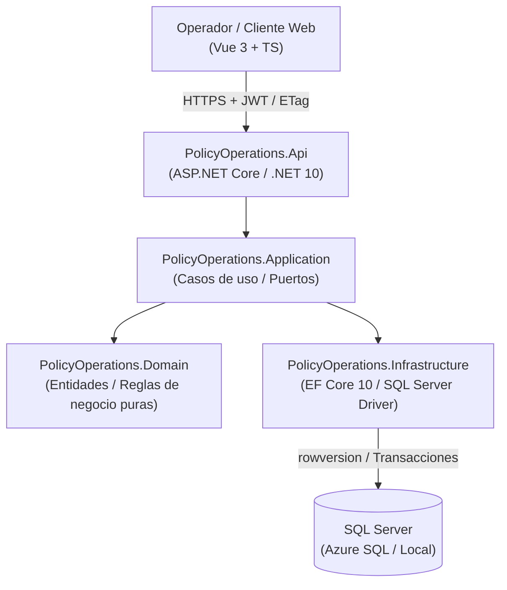

# NainPolicy · Insurance Policy Operations Platform

[](https://policy.naindev.com/)
[](https://github.com/Nain9Dev/API-Gestion-Financiera/actions/workflows/ci.yml)
[](https://github.com/Nain9Dev/API-Gestion-Financiera/actions/workflows/codeql.yml)
[](https://dotnet.microsoft.com/)
[](https://vuejs.org/)
[](LICENSE)

Este repositorio gestiona de forma determinista el ciclo de vida de pólizas aseguradoras con aislamiento estricto por organización, concurrencia optimista (`ETag` / `rowversion`) y un historial de transiciones inmutable (append-only) sobre SQL Server.

El objetivo no es aparentar un SaaS terminado, sino demostrar con código limpio, arquitectura desacoplada y tests verificables cómo diseño sistemas backend empresariales con .NET 10 y frontends reactivos con Vue 3 + TypeScript. Forma parte de la marca técnica de [naindev.com](https://www.naindev.com/) bajo la denominación **NainPolicy**.

> Estado: **demo técnica pública y verificada con datos sintéticos**. Puede probarse por HTTPS sin instalar nada en [https://policy.naindev.com](https://policy.naindev.com) o en local mediante la suite interactiva `PolicyOperations.Client` (puerto 5375). No está autorizada para clientes ni datos personales reales.

## Qué se puede comprobar en 60 segundos

| Quiero… | Dónde |
|---|---|
| Explorar el showcase interactivo (Vue 3) | Demo en vivo en [https://policy.naindev.com](https://policy.naindev.com) o local en puerto `5375` (workbench de ciclo de vida, lab de concurrencia y telemetría) |
| Ver la documentación de la API | [Scalar Docs](http://localhost:8110/docs) (OpenAPI .NET 10 nativo en `/docs`) |
| Ver el flujo funcionando online | [Demo pública](https://policy.naindev.com/) — un clic, sin registro |
| Reproducirlo yo mismo | `curl -i -X POST "https://nain-policy-demo-api.azurewebsites.net/api/v1/demo/run" -H "Accept: application/json"` |
| Ver que las pruebas son reales | [Workflow de CI](https://github.com/Nain9Dev/API-Gestion-Financiera/actions/workflows/ci.yml): la suite de integración corre contra un SQL Server real en cada push |
| Ver qué regla cubre cada test | [docs/traceability.md](docs/traceability.md) |
| Entender los límites declarados | [Límites actuales](#límites-actuales) y [docs/public-demo.md](docs/public-demo.md) |

**Aviso honesto sobre el plan gratuito:** el backend corre en Azure App Service F1 con Azure SQL Free y `AutoPause`. La primera petición tras un rato de inactividad despierta la base de datos y puede tardar bastante. La página lo dice mientras ocurre, la API responde `503` con `Retry-After` en vez de fingir un error interno, y el coste incremental sigue siendo 0 EUR. Es una decisión de coste, no un descuido.

## Capacidades implementadas

- Monolito modular: Domain, Application, Infrastructure y API.
- Creación de pólizas en estado `Draft` con importe y moneda ISO 4217.
- Ciclo `Draft -> Active -> Cancelled`, incluida cancelación directa de Draft.
- Datos mínimos de activación: referencia opaca del asegurado y periodo de cobertura.
- JWT Bearer, roles `PolicyReader` y `PolicyOperator`.
- Organización derivada del claim confiable `organization_id`.
- Lecturas y unicidad de `PolicyNumber` aisladas por organización.
- SQL Server `rowversion`, ETag e `If-Match` para evitar escrituras obsoletas.
- Historial de transiciones con actor, UTC, correlación y motivo.
- Problem Details seguro con stable error codes.
- EF Core 10 y migrations que se niegan a inventar ownership o moneda para datos antiguos.
- Swagger visual, colección `.http` y endpoint de salud del proceso.
- Página de demo sin registro ni descargas que ejecuta un escenario sintético completo.
- Rate limiting, retención de 24 horas y organización dedicada para la demo pública.
- Readiness independiente para comprobar la conexión con SQL Server.
- `503 service_unavailable` con `Retry-After` cuando la base de datos gratuita está despertando; `500` queda reservado para defectos reales.
- Limpieza de la demo tolerante a fallos: si no puede ejecutarse, se registra y la ejecución continúa.
- Evidencia por paso en la demo: método, ruta, estado, ETag y duración medida en servidor.
- Cabeceras de seguridad base en todas las respuestas y CSP restrictiva en la página de demo.
- Tests de dominio, de aplicación sin base de datos, de API, autorización, aislamiento y migrations contra SQL Server 2025 real.

## Arquitectura y Diagrama C4



### Matriz de Decisiones y Trade-Offs

| Dimensión | Decisión adoptada | Alternativa descartada | Razón técnica |
|---|---|---|---|
| **Concurrencia** | Optimista con `rowversion`, ETag e `If-Match` (`412 Precondition Failed`) | Bloqueos pesimistas (`SELECT FOR UPDATE`) | Evita bloqueos en transacciones largas y garantiza escalabilidad horizontal sin estado en HTTP. |
| **Aislamiento Multi-Tenant** | Organización derivada de claim JWT confiable (`organization_id`) y filtrado en repositorio | Base de datos por tenant | Permite ejecución a 0,00 € en Azure SQL Free sin sobrecostes ni orquestación compleja de conexiones. |
| **Auditoría** | Tabla inmutable append-only de transiciones (`PolicyTransitions`) en la misma transacción | Event Sourcing completo | Auditoría estricta y reproducible sin la complejidad operativa ni consistencia eventual de Event Sourcing. |
| **Persistencia** | EF Core 10 con migraciones deterministas | Dapper puro | Modelado formal del ciclo de vida y validación de tipos complejos preservando rendimiento óptimo. |


## Endpoints

| Método | Ruta | Autorización | Comportamiento |
|---|---|---|---|
| `GET` | `/health` | Anonymous | Liveness del proceso; no comprueba SQL Server |
| `GET` | `/health/ready` | Anonymous | Readiness de la conexión con SQL Server |
| `POST` | `/api/v1/demo/run` | Anonymous cuando se habilita | Ejecuta el escenario sintético fijo de cinco pasos |
| `POST` | `/api/v1/policies` | `PolicyOperator` | Crea una póliza `Draft` |
| `GET` | `/api/v1/policies/{policyId}` | Reader u Operator | Recupera una póliza de la organización |
| `GET` | `/api/v1/policies` | Reader u Operator | Lista paginada, máximo 100 elementos |
| `POST` | `/api/v1/policies/{policyId}/activate` | `PolicyOperator` + `If-Match` | Activa un Draft completo |
| `POST` | `/api/v1/policies/{policyId}/cancel` | `PolicyOperator` + `If-Match` | Cancela un Draft o Active |
| `GET` | `/api/v1/policies/{policyId}/transitions` | Reader u Operator | Muestra el historial de estados |

Errores relevantes: `400` validación, `401`/`403` identidad y rol, `404` fuera de la organización, `409` conflicto de estado o de número, `412` ETag obsoleto, `428` falta `If-Match`, `429` límite de la demo y `503` base de datos gratuita despertando.

## Demo visual local

La guía completa está en [docs/local-demo.md](docs/local-demo.md). Resumen:

```powershell
$env:ConnectionStrings__DefaultConnection = "Server=.\NAINCONFIGURATOR;Database=PolicyOperationsLocalDemo;Integrated Security=True;TrustServerCertificate=True;Encrypt=False"
$env:POLICY_OPERATIONS_MIGRATIONS_SQLSERVER = $env:ConnectionStrings__DefaultConnection

dotnet tool restore
dotnet restore .\GestionFinanciera\GestionFinanciera.sln
dotnet tool run dotnet-ef database update --project .\GestionFinanciera\PolicyOperations.Infrastructure --startup-project .\GestionFinanciera\PolicyOperations.Infrastructure --configuration Release

dotnet user-jwts create --project .\GestionFinanciera\PolicyOperations.Api\PolicyOperations.Api.csproj --name demo-operator --role PolicyOperator --role PolicyReader --claim organization_id=11111111-1111-1111-1111-111111111111 --valid-for 8h

dotnet run --project .\GestionFinanciera\PolicyOperations.Api --configuration Release --launch-profile https
```

Abre [https://localhost:7024/swagger](https://localhost:7024/swagger) o [http://localhost:5047/swagger](http://localhost:5047/swagger), selecciona **Authorize** y pega el token local.

En `If-Match`, copia el ETag completo tal como aparece en la cabecera de respuesta, incluidas las comillas: `"AAAAAAAAAAE="`. Pegar solo `AAAAAAAAAAE=` no representa un ETag HTTP válido y la API responderá con `etag_invalid`.

La base `PolicyOperationsLocalDemo` fue creada y migrada en el equipo verificado el 2026-08-02. Contiene exclusivamente evidencia sintética del smoke test local.

Requests alternativas: [PolicyOperations.Api.http](GestionFinanciera/PolicyOperations.Api/PolicyOperations.Api.http).

## Demo de un clic

La página `/demo/` llama a una única operación sin cuerpo y muestra el resultado paso a paso:

```text
201 Draft -> 200 Active -> 412 stale ETag -> 200 Cancelled -> 200 audit
```

El recorrido se ha ejecutado desde un navegador contra SQL Server 2025 local y devolvió dos transiciones de auditoría. La demo no pide un token, no permite introducir texto y elimina registros sintéticos antiguos de su organización dedicada.

Abre [Probar API](https://nain-policy-demo-api.azurewebsites.net/demo/) para ejecutar el recorrido. La configuración de Azure, los límites gratuitos y la evidencia observada están en [docs/public-demo.md](docs/public-demo.md).

## Quality gate verificado

- Build Release: 0 warnings y 0 errores.
- 22 tests de dominio.
- 21 tests de aplicación sin base de datos (catálogo de divisas, paginación, forma del ETag, versión obsoleta y auditoría).
- 21 tests de API, autorización, organización, demo pública, readiness, cabeceras y OpenAPI.
- 4 tests de migrations y recuperación segura.
- 68 tests en la suite; 21 utilizan SQL Server real.
- CI ejecuta la suite de SQL Server contra un contenedor real de SQL Server en cada push, así que la afirmación anterior la verifica el pipeline, no el README.
- CodeQL analiza el código C# en cada push y semanalmente; Dependabot mantiene NuGet y Actions al día.
- EF Core sin cambios de modelo pendientes de migration.
- Auditoría NuGet sin vulnerabilidades conocidas: el paso de CI falla si aparece alguna.
- Smoke test real: `Draft -> Active -> Cancelled`, dos transiciones persistidas mediante JWT local.

## Límites actuales

- El JWT de `dotnet user-jwts` es exclusivamente para desarrollo local.
- La operación pública de demo no sustituye autenticación ni permite trabajar con datos elegidos por el visitante.
- Un piloto requiere un issuer OpenID Connect aprobado y configuración operativa.
- No existe administración de organizaciones, invitaciones o usuarios.
- No se han implementado retención/export del audit trail, restauración probada ni alertas operativas para clientes. La demo sí avisa cuando Azure SQL Free se acerca a su cuota.
- No existe evaluación de riesgo, billing, integraciones ni multi-región.
- El arranque en frío del plan gratuito sigue existiendo: se comunica, no se elimina.
- La corrección de resiliencia está implementada y verificada en local, pero **todavía no desplegada**; hasta que se publique, el `500` medido el 2026-09-08 sigue siendo reproducible en producción.
- No se permiten datos personales reales ni exposición de los puertos locales a internet.
- La capacidad objetivo todavía no tiene un load test reproducible.

## Coste y licencia

La fase local usa herramientas gratuitas: .NET, paquetes open source, MIT para el repositorio y SQL Server 2025 Standard Developer. La demo pública está desplegada en Azure App Service F1 y Azure SQL Free. La base tiene `AutoPause` al agotar la cuota y no puede continuar como uso de pago; una alerta por correo avisa cuando queda aproximadamente el 1 %. El coste incremental autorizado sigue siendo 0 EUR y el límite aprobado antes de exigir evidencia comercial es 40 horas adicionales desde el 2026-08-02.

SQL Server Standard Developer es gratuito para desarrollo/pruebas, pero no está licenciado para producción. Producción requerirá una decisión explícita sobre base de datos, hosting, backups, restauración, privacidad y soporte.

## Documentación

- [Constitución del repositorio (AGENTS.md)](AGENTS.md)
- [Política de seguridad](SECURITY.md)
- [Mapa y autoridad](docs/README.md)
- [Contexto y estado](docs/project-context.md)
- [Reglas de negocio y contratos](docs/business-rules.md)
- [Arquitectura](docs/architecture.md)
- [Roadmap](docs/roadmap.md)
- [Demo local](docs/local-demo.md)
- [Demo pública de un clic](docs/public-demo.md)
- [Economic brief](docs/economic-brief.md)
- [Trazabilidad regla -> test](docs/traceability.md)
- [Changelog](docs/changelog.md)
- [Spec 001: resiliencia del plan gratuito](specs/001-portfolio-demo-resilience/spec.md)
- [ADR-001: product direction](docs/decisions/ADR-001-product-direction.md)
- [ADR-002: runtime and architecture](docs/decisions/ADR-002-runtime-and-architecture.md)
- [ADR-003: lifecycle and security](docs/decisions/ADR-003-lifecycle-security-and-organization-boundary.md)
- [ADR-004: repository license](docs/decisions/ADR-004-repository-license.md)
- [ADR-005: public demo and free hosting](docs/decisions/ADR-005-public-demo-and-free-hosting.md)
- [ADR-006: free-tier resilience and demo evidence](docs/decisions/ADR-006-free-tier-resilience-and-demo-evidence.md) (aprobado)

## Autor

Aitor Nain Mendoza Vallejo — Full Stack Architect & Backend .NET Engineer

[naindev.com](https://www.naindev.com/) · contact@naindev.com
