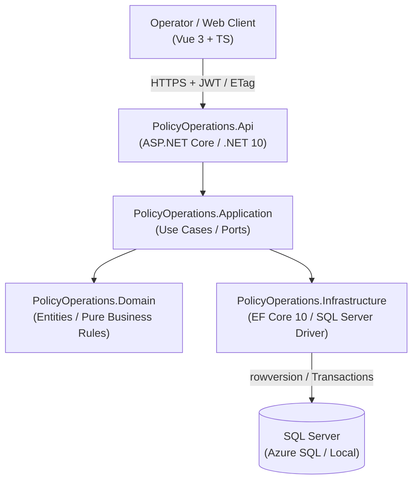

<picture>
  <source media="(prefers-color-scheme: dark)" srcset="docs/assets/banner-dark.svg">
  <source media="(prefers-color-scheme: light)" srcset="docs/assets/banner-light.svg">
  
</picture>

# NainPolicy · Insurance Policy Operations Platform

[](README.md)
[](README.es.md)
[](https://policy.naindev.com/)
[](https://status.naindev.com)
[](https://github.com/Nain9Dev/engineering-handbook)
[](https://github.com/Nain9Dev/engineering-handbook/blob/main/governance/zero-cost-philosophy.md)
[](https://github.com/Nain9Dev/API-Gestion-Financiera/actions/workflows/ci.yml)
[](https://dotnet.microsoft.com/)
[](GestionFinanciera/tests/PolicyOperations.Application.Tests/ArchitectureTests.cs)
[](https://vuejs.org/)
[](LICENSE)

This repository deterministically manages the lifecycle of insurance policies with strict tenant isolation by organization, optimistic concurrency (`ETag` / `rowversion`), and an immutable append-only transition ledger backed by SQL Server.

Its goal is not to pose as a finished commercial SaaS, but to demonstrate clean engineering, decoupled architecture, and verified tests across enterprise backend .NET 10 systems and reactive Vue 3 + TypeScript frontends. It is part of the [naindev.com](https://www.naindev.com/) technical ecosystem under the name **NainPolicy**.

> Status: **Public technical demo verified with synthetic data**. Can be evaluated over HTTPS without local installations at [https://policy.naindev.com](https://policy.naindev.com) or locally via the interactive `PolicyOperations.Client` suite (port 5375). Not authorized for live client records or personal data.

## 60-Second Verification Guide

| Objective | Target |
|---|---|
| Live Architecture Blueprint (Vue 3) | [https://policy.naindev.com](https://policy.naindev.com): interactive blueprint stepping through architectural layers, concurrency `412` guard, and append-only audit ledger |
| API Specification | [Scalar Docs](http://localhost:8110/docs) (Native .NET 10 OpenAPI at `/docs`) |
| Live Interactive Scenario | [Public Demo](https://policy.naindev.com/) — one click, zero sign-up required |
| Local Replay | `curl -i -X POST "https://nain-policy-demo-api.azurewebsites.net/api/v1/demo/run" -H "Accept: application/json"` |
| CI Pipeline & Verification | [CI Workflow](https://github.com/Nain9Dev/API-Gestion-Financiera/actions/workflows/ci.yml): integration test suite executes against real SQL Server on every push |
| Requirement Traceability | [docs/traceability.md](docs/traceability.md) |

**Notice on the free hosting plan:** The backend runs on Azure App Service F1 with Azure SQL Free and `AutoPause`. Cold starts upon inactivity wake the database and may experience latency. The UI communicates this state transparently, the API responds with `503` and `Retry-After` instead of masking server errors, and incremental running cost remains 0.00 EUR.

## Core Capabilities

- Modular Clean Architecture: Domain, Application, Infrastructure, and API.
- Policy creation in `Draft` state with ISO 4217 currency and amount validation.
- Lifecycle: `Draft -> Active -> Cancelled`, including direct Draft cancellation.
- Mandatory activation prerequisites: opaque policyholder reference and coverage window.
- JWT Bearer security with `PolicyReader` and `PolicyOperator` role enforcement.
- Organization scope derived from trusted `organization_id` token claim.
- Policy number uniqueness and data reads isolated by organization boundary.
- SQL Server `rowversion`, ETag, and `If-Match` preventing lost updates.
- Immutable transition ledger recording actor, UTC timestamp, correlation ID, and reason.
- RFC 7807 Problem Details with stable machine-readable error codes.
- EF Core 10 migrations refusing to fabricate legacy ownership or currencies.
- Native OpenAPI discovery, `.http` request collection, and liveness/readiness probes.
- Rate-limited synthetic demo running a fixed 5-step scenario in a dedicated organization.
- Test coverage across pure domain invariants, application use cases, and SQL Server integration.

## Architecture & C4 Model



### Architectural Decisions & Trade-Offs

| Dimension | Selected Approach | Discarded Alternative | Rationale |
|---|---|---|---|
| **Concurrency** | Optimistic with `rowversion`, ETag, and `If-Match` (`412 Precondition Failed`) | Pessimistic locking (`SELECT FOR UPDATE`) | Eliminates long-held transaction locks and enables horizontal stateless HTTP scaling. |
| **Multi-Tenancy** | Organization derived from trusted JWT claim (`organization_id`) filtered at repository layer | Database per tenant | Enables $0.00 operation on Azure SQL Free without connection sprawl or high provisioning costs. |
| **Auditability** | Append-only transition ledger (`PolicyTransitions`) in the same database transaction | Full Event Sourcing | Guaranteed immutable traceability without the operational complexity or eventual consistency of full Event Sourcing. |
| **Persistence** | EF Core 10 with deterministic migrations | Raw Dapper | Formal lifecycle modeling and strong type validation while maintaining high query performance. |

## API Endpoints

| Method | Path | Authorization | Description |
|---|---|---|---|
| `GET` | `/health` | Anonymous | Process liveness probe; does not query SQL Server |
| `GET` | `/health/ready` | Anonymous | Readiness probe verifying active SQL Server connection |
| `POST` | `/api/v1/demo/run` | Anonymous (when enabled) | Executes deterministic 5-step synthetic lifecycle run |
| `POST` | `/api/v1/policies` | `PolicyOperator` | Creates new `Draft` policy |
| `GET` | `/api/v1/policies/{policyId}` | Reader or Operator | Retrieves policy scoped to caller organization |
| `GET` | `/api/v1/policies` | Reader or Operator | Bounded paginated list (maximum 100 items) |
| `POST` | `/api/v1/policies/{policyId}/activate` | `PolicyOperator` + `If-Match` | Activates completed Draft policy |
| `POST` | `/api/v1/policies/{policyId}/cancel` | `PolicyOperator` + `If-Match` | Cancels Draft or Active policy |
| `GET` | `/api/v1/policies/{policyId}/transitions` | Reader or Operator | Retrieves audit trail of status transitions |

## Local Execution

Full instructions in [docs/local-demo.md](docs/local-demo.md). Quickstart:

```powershell
$env:ConnectionStrings__DefaultConnection = "Server=.\NAINCONFIGURATOR;Database=PolicyOperationsLocalDemo;Integrated Security=True;TrustServerCertificate=True;Encrypt=False"
$env:POLICY_OPERATIONS_MIGRATIONS_SQLSERVER = $env:ConnectionStrings__DefaultConnection

dotnet tool restore
dotnet restore .\GestionFinanciera\GestionFinanciera.sln
dotnet tool run dotnet-ef database update --project .\GestionFinanciera\PolicyOperations.Infrastructure --startup-project .\GestionFinanciera\PolicyOperations.Infrastructure --configuration Release

dotnet user-jwts create --project .\GestionFinanciera\PolicyOperations.Api\PolicyOperations.Api.csproj --name demo-operator --role PolicyOperator --role PolicyReader --claim organization_id=11111111-1111-1111-1111-111111111111 --valid-for 8h

dotnet run --project .\GestionFinanciera\PolicyOperations.Api --configuration Release --launch-profile https
```

## Verified Quality Gates

- Release build: 0 warnings and 0 errors.
- 22 domain unit tests.
- 25 application tests without database dependencies.
- API tests covering authorization, isolation, public demo, readiness, and security headers.
- CI verifies SQL Server integration against containerized SQL Server on every push.
- CodeQL analysis enabled for C# codebase.
- NuGet package vulnerability checks passing with zero known advisories.

## Author

Aitor Nain Mendoza Vallejo — Full Stack Architect & Backend .NET Engineer

[naindev.com](https://www.naindev.com/) · contact@naindev.com
